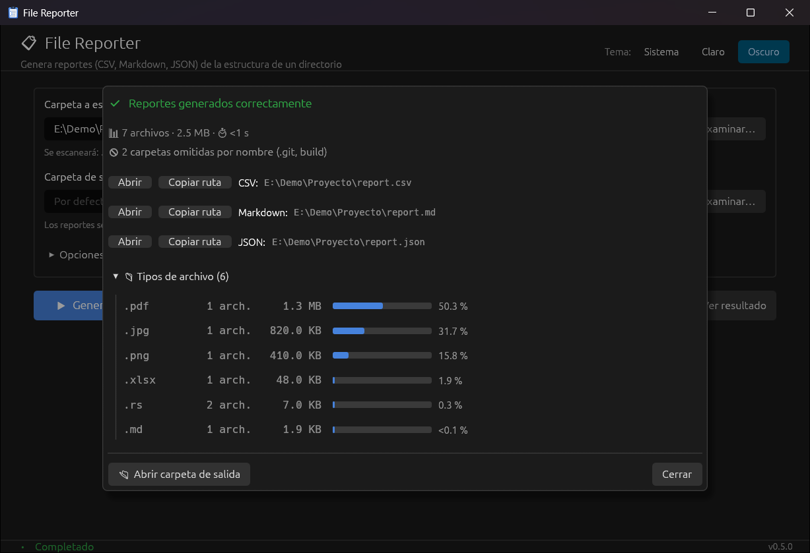
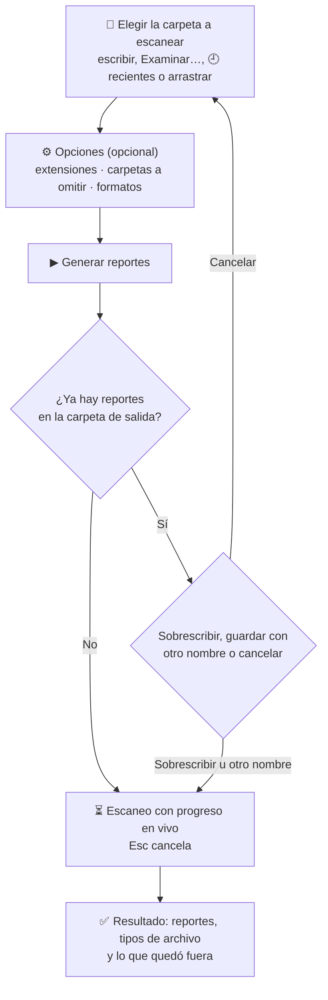
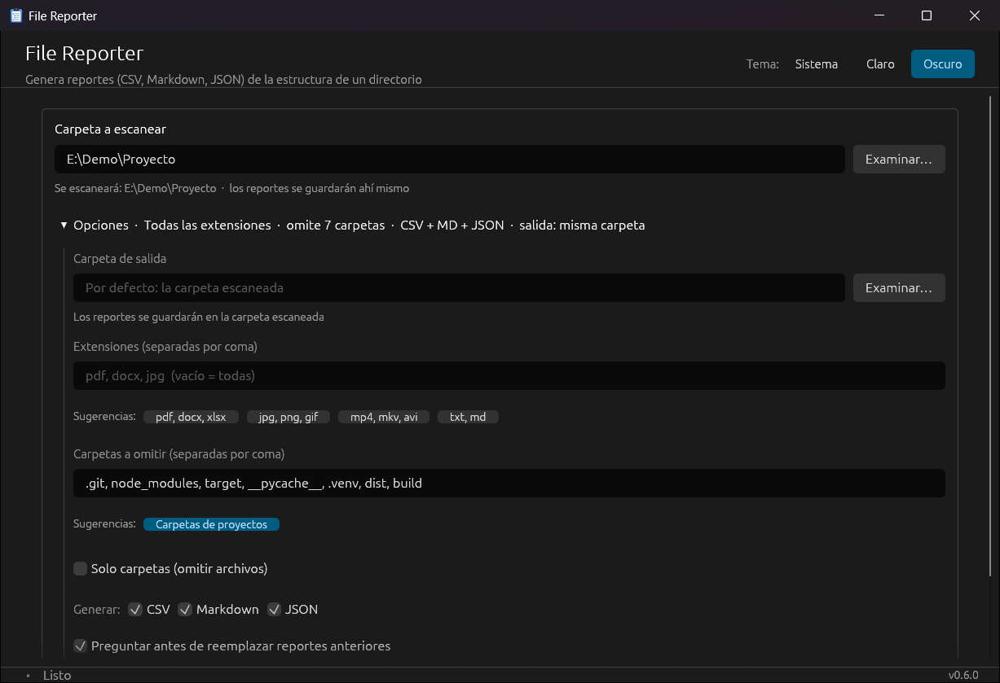
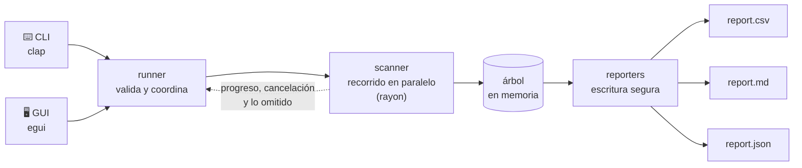
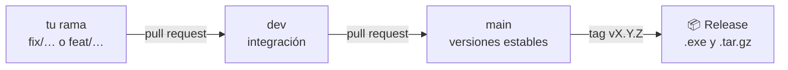

# 📋 File Reporter

[](https://github.com/dbarretol/file-reporter/actions/workflows/ci.yml)
[](https://github.com/dbarretol/file-reporter/releases/latest)
[](LICENSE)


**Escanea una carpeta y obtén, en segundos, un inventario completo de su contenido en CSV, Markdown y JSON.**

File Reporter es una herramienta escrita en Rust que se usa con **interfaz gráfica** (para el día a día) o desde la **línea de comandos** (para scripts y automatización). Recorre la carpeta en paralelo y genera hasta tres reportes con la estructura de carpetas y los datos de cada archivo: tamaño, fechas y ruta.

<p align="center">
  
</p>

---

## ⚡ Inicio rápido

1. Descarga el ejecutable para tu sistema desde [**Releases**](https://github.com/dbarretol/file-reporter/releases/latest).
2. Ábrelo con doble clic, arrastra una carpeta a la ventana y pulsa **▶ Generar reportes**.
3. Los reportes (`report.csv`, `report.md` y `report.json`) quedan en la carpeta escaneada. La ventana de resultado permite abrirlos.

¿Prefieres la terminal?

```bash
file-reporter /ruta/a/escanear
```

---

## Contenido

- [¿Para qué sirve?](#-para-qué-sirve)
- [Características](#-características)
- [Instalación](#-instalación)
- [Uso](#-uso): [interfaz gráfica](#️-interfaz-gráfica) · [línea de comandos](#️-línea-de-comandos)
- [Reportes generados](#-reportes-generados)
- [Cómo funciona](#-cómo-funciona)
- [Desarrollo](#-desarrollo)
- [Hoja de ruta](#-hoja-de-ruta)
- [Contribuciones](#-contribuciones)
- [Licencia](#-licencia)

---

## 💡 ¿Para qué sirve?

- **Auditar un disco o una carpeta compartida:** qué hay, cuánto ocupa y cuándo se modificó, en una hoja de Excel.
- **Documentar la estructura de un proyecto:** copia el árbol de `report.md` en tu documentación.
- **Inventariar tipos concretos de archivo:** por ejemplo, todos los `pdf` y `docx` de una unidad.
- **Alimentar otros procesos:** el JSON jerárquico se integra fácilmente en scripts o pipelines.

---

## ✨ Características

**Reportes**
- 📊 Tres formatos a la vez: **CSV** (listo para Excel), **Markdown** (árbol estilo `tree`) y **JSON** (jerárquico).
- 📅 Datos de cada archivo: nombre, extensión, tamaño (en MB y en bytes exactos), fechas de creación y modificación, y ruta.
- 🗂️ **Resumen por tipo de archivo:** cantidad, tamaño y porcentaje de cada extensión, en la GUI, en la consola y en `report.md`.
- 🎯 **Filtro por extensiones** (`pdf, docx, jpg…`) y **modo solo carpetas** (solo la jerarquía de directorios).
- 🚫 **Omite carpetas por nombre** en cualquier nivel (`.git`, `node_modules`, `target`…) sin llegar a leerlas, y al terminar indica cuántas omitió.
- 🏷️ **Nombre de los reportes a elección**, para no pisar los de otra carpeta.

**Robustez**
- 🚀 Escaneo **en paralelo**, en una sola pasada por el disco.
- 🛡️ Sigue funcionando ante carpetas sin permisos y avisa de qué no pudo leer y por qué.
- 🔁 No sigue enlaces simbólicos ni *junctions*, así que no se queda atrapado en ciclos.
- 💾 **Escritura segura:** si algo falla al guardar un reporte (disco lleno, archivo abierto en Excel…), el anterior queda intacto.
- 🔒 CSV protegido contra *formula injection*.

**Interfaz gráfica**
- 🖱️ Arrastra una carpeta, usa "Examinar…" o elige una de las 5 últimas (🕘).
- 🧭 Formulario simple: lo esencial arriba y el resto en **Opciones**, con un resumen de lo elegido.
- 📈 Progreso en vivo (archivos encontrados y carpetas revisadas); **cancela** en cualquier momento con Esc.
- 🧾 Resultado claro: reportes (abrir o copiar su ruta), tipos de archivo y lo que quedó fuera, con su motivo.
- ⚠️ Antes de sobrescribir reportes anteriores, ofrece guardar los nuevos con otro nombre.
- 🎨 Tema claro, oscuro o el del sistema; recuerda rutas y opciones entre sesiones.

**Línea de comandos**
- 🧩 Las mismas opciones que la GUI, listas para scripts.
- ⏳ Indicador de progreso mientras escanea (se oculta si la salida se redirige).
- 🔎 `-v`: lista lo omitido y el motivo.

---

## 📦 Instalación

### Descargar el ejecutable

En [**Releases**](https://github.com/dbarretol/file-reporter/releases/latest) hay ejecutables listos para usar, sin instalar nada más:

| Sistema | Archivo |
|---|---|
| Windows (64 bits) | `file-reporter-vX.Y.Z-windows-x64.exe` |
| Linux (64 bits) | `file-reporter-vX.Y.Z-linux-x64.tar.gz` |

- **Windows:** abre el `.exe` con doble clic. Como el ejecutable no está firmado, SmartScreen puede avisar la primera vez: *Más información → Ejecutar de todas formas*.
- **Linux:** descomprime el archivo y ejecuta `./file-reporter`. La interfaz gráfica necesita GTK 3, que traen la mayoría de escritorios.

<details>
<summary>Comprobar que la descarga está íntegra (opcional)</summary>

<br>

Cada *Release* incluye `SHA256SUMS.txt` con la suma SHA256 de cada ejecutable. Descárgalo junto al ejecutable y compara:

```powershell
# Windows (PowerShell): debe coincidir con el valor de SHA256SUMS.txt (sale en mayúsculas)
(Get-FileHash .\file-reporter-vX.Y.Z-windows-x64.exe -Algorithm SHA256).Hash
```

```bash
# Linux: comprueba los archivos de la lista que estén en la carpeta
sha256sum -c --ignore-missing SHA256SUMS.txt
```

</details>

### Compilar desde el código fuente

Requisitos:

- [Rust](https://rustup.rs/) 1.95 o superior (toolchain estable).
- **Solo en Linux:** dependencias del sistema para la GUI y los diálogos nativos:
  ```bash
  sudo apt install libgtk-3-dev libxkbcommon-dev libwayland-dev
  ```

```bash
git clone https://github.com/dbarretol/file-reporter.git
cd file-reporter
cargo build --release
```

El ejecutable queda en `target/release/file-reporter` (`file-reporter.exe` en Windows).

> Se prueba en **Windows** y **Linux** en cada cambio. En macOS debería compilar, pero no se prueba.

---

## 🚀 Uso

El mismo ejecutable funciona en dos modos:

| Cómo lo ejecutas | Modo |
|---|---|
| Sin argumentos (o con doble clic) | 🖥️ Interfaz gráfica |
| Con una carpeta como argumento | ⌨️ Línea de comandos |

### 🖥️ Interfaz gráfica



1. Elige la **carpeta a escanear**: escribe la ruta, pulsa "Examinar…", elige una reciente con 🕘 o arrástrala a la ventana. Debajo se ve el final de la ruta, por si el campo la corta.
2. *(Opcional)* Elige una **carpeta de salida**. Por defecto, la misma carpeta escaneada.
3. *(Opcional)* Despliega **Opciones**. Plegado, muestra un resumen de lo elegido (p. ej. "Todas las extensiones · omite 7 carpetas · CSV + MD + JSON"). Dentro puedes:
   - escribir las **extensiones** a incluir (las sugerencias se suman a lo escrito; pulsarlas otra vez las quita);
   - revisar las **carpetas a omitir** por nombre. De partida se omiten `.git`, `node_modules`, `target`, `__pycache__`, `.venv`, `dist` y `build`; vacía el campo para incluirlas;
   - marcar **Solo carpetas** para obtener solo la jerarquía de directorios;
   - desmarcar los **formatos** que no necesites.
4. Pulsa **▶ Generar reportes** (o Enter, si no estás escribiendo en un campo). Al terminar se abre la ventana de resultado. Ciérrala con **Cerrar**, Enter o Esc; el botón **Ver resultado** la vuelve a abrir.

<p align="center">
  
</p>

### ⌨️ Línea de comandos

```bash
# Todo el contenido de una carpeta
file-reporter /ruta/a/escanear

# Solo ciertas extensiones (separadas por coma o con -e repetido)
file-reporter /ruta --ext pdf,docx
file-reporter /ruta -e jpg -e png

# Guardar los reportes en otra carpeta y con otro nombre (facturas.csv, …)
file-reporter /ruta -o /ruta/reportes -n facturas

# Solo la estructura de carpetas, o solo algunos formatos
file-reporter /ruta -d
file-reporter /ruta -f csv,md

# Omitir carpetas por nombre (.git, node_modules, target… con --exclude-common)
file-reporter /ruta --exclude-common
file-reporter /ruta -x "mis fotos" -x tmp,cache

# Ver qué se omitió y por qué (sin permisos, enlaces, exclusiones)
file-reporter /ruta -v
```

En Windows (PowerShell):

```powershell
.\file-reporter.exe "D:\MisDocumentos" -e pdf,docx -o "D:\reportes"
```

Así se ve una ejecución sobre un proyecto de ejemplo:

```text
> file-reporter E:\Demo\Proyecto --exclude-common
🚫 Omitiendo carpetas: .git, node_modules, target, __pycache__, .venv, dist, build
🔍 Escaneando: E:\Demo\Proyecto

✅ Reportes generados correctamente:
   📄 CSV:      E:\Demo\Proyecto\report.csv
   📄 Markdown: E:\Demo\Proyecto\report.md
   📄 JSON:     E:\Demo\Proyecto\report.json

📊 Archivos procesados: 7 · 2.5 MB

🗂️  Tipos de archivo (por tamaño):
   .pdf                     1 arch. ·    1.3 MB ·  50.3 %
   .jpg                     1 arch. ·  820.0 KB ·  31.7 %
   .png                     1 arch. ·  410.0 KB ·  15.8 %
   .xlsx                    1 arch. ·   48.0 KB ·   1.9 %
   .rs                      2 arch. ·    7.0 KB ·   0.3 %
   .md                      1 arch. ·    1.9 KB ·  <0.1 %
🚫 2 carpetas omitidas por nombre (.git, build)
⏱️  Tiempo: <1 s
```

| Opción | Descripción |
|---|---|
| `<PATH>` | Carpeta a escanear **(obligatorio)** |
| `-e`, `--ext` | Extensiones a incluir, separadas por coma, punto y coma o espacio (`"pdf, .DOCX"` vale). Sin esta opción se incluyen todas |
| `-o`, `--output` | Carpeta de salida (por defecto: la carpeta escaneada) |
| `-n`, `--name` | Nombre de los reportes, sin extensión (`-n facturas` → `facturas.csv`, `facturas.md`, `facturas.json`). Por defecto, `report` |
| `-d`, `--dirs-only` | Solo estructura de carpetas. No se puede combinar con `-e` |
| `-x`, `--exclude` | Carpeta a omitir por nombre (no por ruta), en cualquier nivel y con todo su contenido. Se puede repetir o separar por comas |
| `--exclude-common` | Omite `.git`, `node_modules`, `target`, `__pycache__`, `.venv`, `dist` y `build` |
| `-f`, `--format` | Reportes a generar: `csv`, `md` (o `markdown`), `json`, separados por coma. Sin esta opción se generan los tres |
| `-v`, `--verbose` | Muestra qué se omitió y por qué: carpetas y archivos sin acceso, enlaces no seguidos y carpetas excluidas por nombre. `-vv` añade el detalle interno del proceso |
| `-h`, `--help` / `-V`, `--version` | Ayuda / versión |

Mientras escanea, la terminal muestra cuántos archivos lleva encontrados, cuántas carpetas ha revisado y el tiempo transcurrido. Al terminar, el indicador desaparece y queda el resumen. Si la salida se redirige a un archivo, o con `-v`, no se muestra. Los errores se muestran en una línea (`❌ La ruta no existe: …`) y el programa termina con código 1.

> **Sobre las extensiones:** se usa lo que va tras el **último** punto del nombre. `foo.tar.gz` tiene extensión `gz`, no `tar.gz`. Los archivos sin punto (`LICENSE`, `Makefile`) no tienen extensión y quedan fuera de cualquier filtro.

---

## 📁 Reportes generados

Cada ejecución crea en la carpeta de salida los reportes elegidos (los tres por defecto). Se llaman `report.*` salvo que se elija otro nombre con `-n` o, en la GUI, con "Guardar con otro nombre" al ir a sobrescribir.

| Archivo | Contenido | Ideal para |
|---|---|---|
| `report.csv` | Una fila por archivo con todos sus datos | Excel, Pandas, hojas de cálculo |
| `report.md` | Árbol de carpetas y archivos estilo `tree`, y tabla de tipos de archivo | Documentación, READMEs |
| `report.json` | Árbol completo con los datos de cada archivo | Scripts e integraciones |

- Los reportes de ejecuciones anteriores que haya en la carpeta escaneada no se incluyen en el nuevo reporte.
- En **modo solo carpetas**, `report.md` y `report.json` contienen solo directorios y `report.csv` queda solo con la cabecera (lo mismo si el filtro de extensiones no encuentra nada).

<details>
<summary><b>📊 report.csv</b>: columnas</summary>

<br>

UTF-8 con BOM y separador `;`, para que Excel lo abra correctamente sin configurar nada.

| Columna | Descripción |
|---|---|
| `name` | Nombre del archivo, sin extensión |
| `extension` | Extensión, sin punto |
| `size_mb` | Tamaño en MB con 3 decimales y coma decimal (`1,270`), como lo espera Excel en español |
| `size_bytes` | Tamaño exacto en bytes |
| `created` / `modified` | Fechas en `DD/MM/AAAA` según la hora local del equipo, las mismas que muestra el explorador de archivos (formato que Excel reconoce directamente) |
| `created_iso` / `modified_iso` | Fecha y hora local en ISO-8601, con el desfase respecto de UTC (`2026-11-12T14:13:21-05:00`), fáciles de ordenar y procesar |
| `directory` | Carpeta que contiene el archivo |
| `full_path` | Ruta completa |

```text
name;extension;size_mb;size_bytes;created;modified;created_iso;modified_iso;directory;full_path
manual;pdf;1,270;1331200;12/11/2026;12/11/2026;2026-11-12T14:13:21.368492800-05:00;2026-11-12T14:13:21.369491400-05:00;E:\Demo\Proyecto\docs;E:\Demo\Proyecto\docs\manual.pdf
presupuesto;xlsx;0,047;49152;12/11/2026;12/11/2026;2026-11-12T14:13:21.370620500-05:00;2026-11-12T14:13:21.370620500-05:00;E:\Demo\Proyecto\docs;E:\Demo\Proyecto\docs\presupuesto.xlsx
```

Si un nombre, extensión o ruta empieza por `=`, `+`, `-`, `@`, tabulador o retorno de carro, se le antepone un apóstrofo para que Excel no lo ejecute como fórmula.

</details>

<details>
<summary><b>🌳 report.md</b>: árbol de directorios</summary>

<br>

````markdown
# 📋 Estructura de Directorios

```
E:\Demo\Proyecto
├── docs
│   ├── manual.pdf
│   └── presupuesto.xlsx
├── fotos
│   ├── equipo.png
│   └── portada.jpg
├── src
│   ├── utils
│   │   └── helpers.rs
│   └── main.rs
└── README.md
```

## 📊 Tipos de archivo

| Extensión | Archivos | Tamaño | % del tamaño |
|---|--:|--:|--:|
| .pdf | 1 | 1.3 MB | 50.3 % |
| .jpg | 1 | 820.0 KB | 31.7 % |
| .png | 1 | 410.0 KB | 15.8 % |
| .xlsx | 1 | 48.0 KB | 1.9 % |
| .rs | 2 | 7.0 KB | 0.3 % |
| .md | 1 | 1.9 KB | <0.1 % |
````

La tabla lista todas las extensiones, de mayor a menor tamaño total; no aparece en modo solo carpetas.

</details>

<details>
<summary><b>🧩 report.json</b>: estructura jerárquica</summary>

<br>

```json
{
  "type": "directory",
  "name": "Proyecto",
  "path": "E:\\Demo\\Proyecto",
  "children": [
    {
      "type": "directory",
      "name": "docs",
      "path": "E:\\Demo\\Proyecto\\docs",
      "children": [
        {
          "type": "file",
          "name": "manual.pdf",
          "path": "E:\\Demo\\Proyecto\\docs\\manual.pdf",
          "size_mb": 1.26953125,
          "size_bytes": 1331200,
          "extension": "pdf",
          "created": "2026-11-12T14:13:21.368492800-05:00",
          "modified": "2026-11-12T14:13:21.369491400-05:00"
        }
      ]
    }
  ]
}
```

(Fragmento: el resto de carpetas y archivos sigue la misma forma.)

</details>

---

## 🔧 Cómo funciona

La CLI y la GUI comparten la misma lógica; solo cambia cómo reciben la configuración y cómo muestran el progreso.



```text
build.rs             # Windows: incrusta el icono y la versión en el .exe
src/
├── main.rs          # Punto de entrada: decide entre CLI y GUI
├── cli.rs           # Modo CLI: argumentos (clap), indicador de progreso y resumen final
├── gui/             # Interfaz gráfica (egui/eframe)
│   ├── mod.rs       # Arranque, estado de la app y paneles fijos
│   ├── form.rs      # Formulario, validación de rutas y botones
│   ├── run.rs       # Estado de la ejecución e hilo de escaneo
│   ├── results.rs   # Progreso y ventana de resultado
│   ├── dialogs.rs   # Diálogo de sobrescritura y arrastrar y soltar
│   └── …            # widgets, paleta de colores, utilidades
├── icon.rs          # Icono de la app, dibujado por código (sin imágenes)
├── runner.rs        # Flujo común: validar → escanear → escribir reportes
├── naming.rs        # Nombre de los reportes: validación y nombre automático
├── summary.rs       # Textos del resumen que comparten CLI y GUI (tamaños, tipos, avisos)
├── scanner.rs       # Recorrido paralelo de la carpeta
├── models.rs        # Node (árbol), FileRecord (fila del CSV) y ExtStat (tipos)
└── reporters/       # Un módulo por formato; escritura segura a través de un temporal
    ├── csv.rs       # CSV para Excel (BOM + ;)
    ├── markdown.rs  # Árbol estilo tree y tabla de tipos
    └── json.rs      # JSON con formato legible
tests/cli.rs         # Tests que ejecutan el programa compilado
```

<details>
<summary><b>Detalles de implementación</b></summary>

<br>

- **Una sola pasada por el disco:** no se cuentan los archivos antes de escanearlos. El progreso se informa en vivo mientras se recorre el árbol.
- **Pocas llamadas al sistema:** el tipo y los datos de cada entrada salen de la propia lectura del directorio (en Windows, sin abrir cada archivo); los archivos que no pasan el filtro se descartan antes de leer sus datos, y el CSV y el Markdown se escriben directamente desde el árbol, sin una copia intermedia en memoria.
- **Escritura segura:** cada reporte se escribe en un archivo temporal que solo reemplaza al anterior si todo fue bien.
- **Symlinks y junctions:** no se siguen (se detectan con el tipo de la entrada), lo que evita ciclos. La carpeta raíz elegida por el usuario sí se sigue aunque sea un enlace (por ejemplo, carpetas de OneDrive).
- **Errores por elemento:** una carpeta sin permisos se omite y se registra; no detiene el escaneo. Las carpetas omitidas a propósito (por nombre) no cuentan como errores. Cada omisión se registra con [`tracing`](https://crates.io/crates/tracing), que la CLI muestra con `-v`.
- **GUI siempre responsiva:** el escaneo corre en un hilo aparte con pila ampliada y `catch_unwind`, de modo que un fallo interno se muestra como error y no cierra la aplicación. Las rutas del formulario se comprueban en otro hilo cuando llevan 300 ms sin cambiar, así que una carpeta de red lenta no congela la ventana.
- **Rutas Unicode:** acentos y emojis se conservan en los tres reportes, y la exclusión de los propios reportes compara rutas sin distinguir mayúsculas, también fuera de ASCII.

</details>

### Tecnologías

[`clap`](https://crates.io/crates/clap) (CLI) ·
[`indicatif`](https://crates.io/crates/indicatif) (progreso en la CLI) ·
[`tracing`](https://crates.io/crates/tracing) (registro con `-v`) ·
[`egui`/`eframe`](https://github.com/emilk/egui) (GUI) ·
[`rfd`](https://crates.io/crates/rfd) (diálogos nativos) ·
[`rayon`](https://crates.io/crates/rayon) (paralelismo) ·
[`serde`](https://crates.io/crates/serde) + [`serde_json`](https://crates.io/crates/serde_json) ·
[`csv`](https://crates.io/crates/csv) ·
[`chrono`](https://crates.io/crates/chrono) ·
[`anyhow`](https://crates.io/crates/anyhow) ·
[`winresource`](https://crates.io/crates/winresource) (icono del `.exe`)

---

## 🧪 Desarrollo

```bash
cargo test                                  # tests unitarios y de la CLI (tests/cli.rs)
cargo fmt --check                           # formato
cargo clippy --all-targets -- -D warnings   # lint
cargo run --profile fast                    # probar la app: recompila en segundos (sin LTO)
```

`--release` activa LTO, que da el ejecutable más rápido pero tarda minutos en recompilar; el perfil `fast` optimiza casi igual y es el indicado mientras se desarrolla.

Los tests trabajan sobre un sistema de archivos real (carpetas temporales con [`tempfile`](https://crates.io/crates/tempfile)). Cubren el escaneo, los filtros, la exclusión de carpetas, el modo solo carpetas, la cancelación, la escritura segura y los tres formatos de salida, además de la CLI como programa (opciones, códigos de salida y mensajes de error). En Windows también crean *junctions* para probar el manejo de enlaces sin permisos de administrador.

Cada push a `main` o `dev` y cada pull request pasan por [GitHub Actions](.github/workflows/ci.yml) en Windows y Ubuntu, y además se comprueba que el proyecto compila con la versión mínima de Rust (1.95). Al subir un tag `vX.Y.Z`, [otro workflow](.github/workflows/release.yml) compila los ejecutables y prepara un borrador de *Release* con sus sumas SHA256 y las notas de [`CHANGELOG.md`](CHANGELOG.md). [Dependabot](.github/dependabot.yml) propone cada mes las actualizaciones de dependencias y de Actions.

---

## 🧭 Hoja de ruta

- [ ] Instalador `.msi` para Windows ([#15](https://github.com/dbarretol/file-reporter/issues/15)).
- [ ] Vista previa del árbol antes de exportar ([#13](https://github.com/dbarretol/file-reporter/issues/13)).
- [ ] Compatibilidad con lectores de pantalla ([#53](https://github.com/dbarretol/file-reporter/issues/53)).

Los cambios de cada versión están en [`CHANGELOG.md`](CHANGELOG.md).

---

## 🤝 Contribuciones

Las contribuciones son bienvenidas. Para cambios grandes, abre primero un *issue* para comentar la propuesta. Después, haz un fork, crea una rama desde `dev` y envía un *pull request* contra `dev` describiendo los cambios.



---

## 📝 Licencia

Distribuido bajo la licencia **MIT**. Consulta [`LICENSE`](LICENSE).

Desarrollado por [@dbarretol](https://github.com/dbarretol) como proyecto de aprendizaje en Rust. Si te resulta útil, deja una ⭐.
